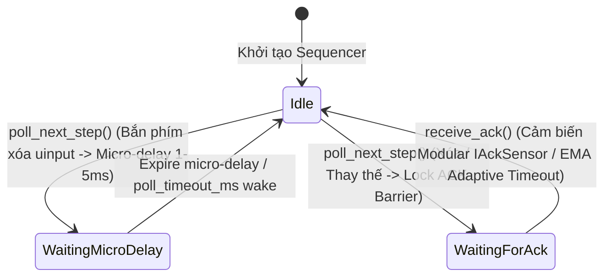

# MODULE: SEQUENCER LAYER (`src/sequencer/` & `fcitx5-lilypad/src/`)

@status: STABLE (v2.4.13-single-fifo-batch-commit) | @last_update: 2026-11-07

> **Ghi chú Kiến trúc:** Hệ thống sử dụng **Kiến trúc Cảm biến Vòng lặp Kép (Dual-Sensor Control Loop) & Single FIFO Consolidated Batch Commit (v2.4.13)**:
> 1. **`IAckSensor` (Cảm biến Đường truyền & Micro-Pacing):** Đo độ trễ vòng lặp Compositor/App roundtrip và tính toán độ trễ vi mô thích ứng `get_micro_delay_us(bsCount, iki_ms)` qua `fcitx5-lilypad/src/ack-sensors/`.
> 2. **`IIkiSensor` (Cảm biến Ngón tay):** Đo nhịp gõ thời gian thực ($\Delta t$) ngón tay người dùng và tính EMA IKI qua `fcitx5-lilypad/src/iki-sensors/`. Nén độ trễ ngắt nhịp xuống $1.0\text{ms} \sim 2.5\text{ms}$ khi gõ lướt Burst Typing.
> 3. **Consolidated Batch Commit Pipeline (v2.4.13):** Khi hoàn tất giao dịch xóa uinput + Hardware Barrier F24, toàn bộ các phím gõ đệm trong RAM (`buffered_keys_`) được gom thành một chuỗi duy nhất và xả 1 lần qua `ic_->commitString()`, loại bỏ các nhịp timer 2ms gây giật lag DOM trên Chromium/Electron.

---

## 1. TỔNG QUAN VÀ VAI TRÒ KẾT NỐI (OVERVIEW)

**Sequencer Layer** (`lilypad-sequencer.h/.cpp` / `ImeEventQueue`) là Trái tim Điều phối Sự kiện của dự án **`fcitx5-lilypad`** (`vnlilypad-lotus`). Module này chịu trách nhiệm quản lý luồng sự kiện gõ giữa Compositor (Niri / Wayland / X11), Ứng dụng (Chrome, AFFiNE, VS Code, Terminal) và Engine xử lý Tiếng Việt (Bamboo Telex/VNI).

> **Nhiệm vụ cốt lõi:** Triệt tiêu $100\%$ hiện tượng đè phím, lặp từ `mminimln`, đảo chữ `choa` và trôi con trỏ bằng cách duy trì Hàng đợi Tuần tự Vi bước **Micro-Step State Machine**, kết hợp **Serial ID Tagging**, **Modular IAckSensor & IIkiSensor Dual-Loop Barrier**, và **Optimized Batch Replay Protocol**.

---

## 2. KIẾN TRÚC MÁY TRẠNG THÁI MICRO-STEP (MICRO-STEP STATE MACHINE)



### Chi tiết các Trạng thái (`BarrierState`):
- **`Ready` (Idle)**: Hàng đợi sẵn sàng. Khi nhận action mới từ Engine, `poll_next_step()` sẽ pop `MicroStep` tiếp theo ra dispatch.
- **`WaitingMicroDelay`**: Tạm dừng $1.0 \sim 5.0\,\text{ms}$ (co giãn theo IKI Fast-Path) sau khi phát phím xóa `KEY_BACKSPACE` để Compositor & App render sạch phím xóa trước khi chèn chữ mới.
- **`WaitingForAck`**: Rào chắn bị khóa chờ tín hiệu `receive_ack()` từ Cảm biến `IAckSensor`.
- **`AppLagHolding`**: Tự động kích hoạt khi chạm Soft Timeout ($T_{\text{elapsed}} \ge T_{\text{soft}}$), tạm ngừng bắn uinput tiếp theo và gom phím an toàn vào RAM `buffered_keys_` chờ App bắt kịp.
- **`SettlingDelay` (Phase 8.2 - Stable v2.3.8)**: Khoảng nghỉ lắng đọng vi mô ($7\text{ms}$ context-aware floor) sau khi nhịp xóa uinput hoàn tất, chờ Event Loop của ứng dụng (DOM reconciliation / Rich Editor parser của TikTok) ổn định vị trí con trỏ trước khi commit ký tự mới. Khóa cứng hàng đợi Sequencer (`is_deleting_`) bảo đảm giao dịch nguyên tử (Atomic Transaction).

---

## 4. CƠ CHẾ BẢO VỆ CHỐNG NẢY TIÊU ĐIỂM (FOCUS BOUNCE PROTECTION - PHASE 8.1 - STABLE v2.3.7)
- **Vấn đề:** Trình duyệt Chromium/Electron trên các trang web động (như TikTok Web, Lexical Editor) thường xuyên bắn sự kiện `FocusOut` $\to$ `FocusIn` ngầm trong khoảng thời gian siêu ngắn ($5\text{ms} \sim 20\text{ms}$) khi re-render thẻ HTML.
- **Giải pháp:** Cơ chế **100ms Focus-Out Deferral** (`deferred_focus_out_`, `cancelDeferredFocusOut`, `flushDeferredFocusOut`):
  - Khi nhận `FocusOut` ở chế độ Uinput/Sequence, Sequencer/State đặt cờ `deferred_focus_out_ = true` và bấm giờ `last_deactivate_time_`, không xóa đệm và không reset Bamboo Engine.
  - Nếu `FocusIn` quay lại trong $< 100\text{ms}$ (Focus Bounce) $\implies$ Gọi `cancelDeferredFocusOut()`, giữ nguyên vẹn 100% bộ nhớ từ đang gõ dở (`oldPreBuffer_`) và trạng thái engine trong RAM.
  - Nếu quá $100\text{ms}$ không quay lại $\implies$ Gọi `flushDeferredFocusOut()` thực thi `resetNow(true)` an toàn khi người dùng chuyển ứng dụng thật.

---

## 3. CHIẾN LƯỢC ĐIỀU PHỐI ADAPTIVE & TWO-TIER TIMEOUT (PHASE 4.3)

> **Tài liệu Kỹ thuật Chi tiết:** Xem giải thích toán học EMA và Hướng dẫn đóng góp Sensor mới tại [niri-ack-sensor-architecture.md](file:///home/chiconcota/Documents/vnlilypad-lotus/.fcitx5-lilypad-ai/3-modules/sequencer-layer/niri-ack-sensor-architecture.md), [iki-adaptive-architecture.md](file:///home/chiconcota/Documents/vnlilypad-lotus/.fcitx5-lilypad-ai/3-modules/sequencer-layer/iki-adaptive-architecture.md), và Đặc tả công thức vi trễ 4 bước tại [dynamic-delay-specification.md](file:///home/chiconcota/Documents/vnlilypad-lotus/.fcitx5-lilypad-ai/3-modules/sequencer-layer/dynamic-delay-specification.md).

```text
┌────────────────────────────────────────────────────────────────────────┐
│                   HỆ THỐNG TIMEOUT 2 TẦNG (TWO-TIER)                   │
│                                                                        │
│  1. Baseline kỳ vọng: T_expected = micro_delay + EMA_App_ACK           │
│  2. Soft Timeout (Dynamic App Lag): T_soft = clamp(max(2.0*T_exp,      │
│                                    min(IKI, T_exp+30)), 35ms, 120ms)   │
│     -> AppLagHolding: Giữ phím RAM, chống rách chữ tiếng Việt.         │
│  3. Hard Timeout (Watchdog 300ms): Cắt lỗ khẩn cấp purgeContextEmergency│
│     -> Reset Bamboo Engine, Word Buffer và xả phím thô an toàn.        │
└────────────────────────────────────────────────────────────────────────┘
```

| Môi trường Compositor / App | Giao thức Cảm biến (`IAckSensor`) | Cơ chế Điều phối Sequencer | Đặc tính Hiệu năng |
| :--- | :--- | :--- | :--- |
| **Niri Compositor (Wayland)** | `NiriAckSensor` (EMA Machine Learning + N+1 Sentinel Barrier + App ACK Consumption) | Phát $N+1$ phím Backspace từ uinput, nuốt phím $N+1$ làm Sentinel Barrier. Tích hợp công thức Lerp động: $\Delta t = \text{lerp}(1\text{ms}, 15\text{ms}, t) + N \cdot \max(\text{lerp}(0.5\text{ms}, 18\text{ms}, t), T_{\text{ack}})$. | Tức thì $2.5\text{ms} \sim 3.0\text{ms}$ trên Terminal, giữ trần $>50\text{ms}$ an toàn tuyệt đối cho Facebook / Web DOM. Cold Start $>50\text{ms}$ cho chữ đầu tiên. |
| **Generic Wayland / Hyprland / Sway / KDE / GNOME** | `GenericAckSensor` (Fallback Adaptive Sensor) | Điều phối qua màng ngắt nhịp vi mô kết hợp rào chắn Sentinel $N+1$ và công thức Lerp thích ứng chung. | Đảm bảo an toàn $100\%$ không bị đè chữ, nuốt đuôi từ hay kẹt phím trên mọi distro. |
| **Terminal Emulators (Foot / Alacritty / Kitty)** | Batch Replay & Backspace Passthrough Protocol | Phân biệt phím `Space` (hoãn 3ms chống đè IPC) và phím thường (`a, b, c...` - xả tức thì 0.3ms). | Triệt tiêu $100\%$ lỗi xé lẻ gói tin và lặp rác chữ trên Terminal. |

---

## 4. BẢNG THÔNG SỐ VÀ CẤU TRÚC DỮ LIỆU (API REFERENCE)

### `lilypad-sequencer.h` (C++ Sequencer Interface)
- `push_step(MicroStep step)`: Thêm vi bước vào hàng đợi với `serial` tăng dần nguyên tử.
- `poll_next_step()`: Lấy vi bước tiếp theo nếu rào chắn ngắt nhịp/ACK đang mở.
- `receive_ack()`: Giải phóng rào chắn ACK khi cảm biến `IAckSensor` nhận tín hiệu đồng bộ, tự động tính toán adaptive delay.
- `calculate_soft_timeout_ms(iki_ms)`: Tính toán ngưỡng Soft Timeout động theo nhịp ngón tay và độ trễ App.
- `is_soft_timeout(iki_ms)` / `is_hard_timeout()`: Kiểm tra trạng thái quá hạn của giao dịch hiện tại.
- `stale_step_pruning()`: Lọc bỏ các vi bước cũ (`step.serial < active_serial_`) chống kẹt hàng đợi.

---

## 5. BẢO VỆ AN TOÀN & APTOMAT KHẨN CẤP (WATCHDOG & POST-COMMIT SETTLING)
- **Watchdog Hard Timeout (300ms toàn hệ thống - v2.3.13):**
  - Giữ ngưỡng an toàn chuẩn $300\text{ms}$ thống nhất cho toàn bộ hệ thống (`purgeContextEmergency()`), tạo $50\text{ms}$ vùng thở an toàn chống false alarm khi Chromium V8 GC lag, bảo đảm bàn phím không bao giờ bị đơ/freeze ngay cả khi ứng dụng gặp sự cố.
  - Loại bỏ các cờ hack riêng biệt để triệt tiêu nợ kỹ thuật (Zero Technical Debt).
- **Hàm `purgeContextEmergency()`:** Nếu xảy ra freeze/lag quá ngưỡng Watchdog, hệ thống lập tức cắt lỗ trạng thái, reset Engine và xả phím thô trong RAM, đảm bảo bàn phím an toàn tuyệt đối.
- **Asymmetric Dynamic Governor & Chained Replacement Protection (Phase 8.3 - v2.3.10):**
  - Khắc phục triệt để lỗi mất chữ kép "thấy -> th" trên Chromium do Post-Commit Window bị co quá ngắn.
  - Tách độc lập 2 mắt xích:
    * Pre-Commit Settling Delay: Thích ứng động theo `swallow_duration_us * 0.8` (co về $1.8\text{ms} \sim 2\text{ms}$ trên tab mượt, nổ chữ tức thì, không bị clamp $12\text{ms}$ bởi IKI).
    * Post-Commit Settling Window: Giữ sàn an toàn $70\text{ms}$ trên Chromium (tự dãn nở lên $100\text{ms}$ trên tab lag), bảo vệ 100% các từ có thay thế biến âm liên tiếp.
  - Tự động nhận diện mức tải từng tab thời gian thực qua `isTabLagging()` dựa trên 4 tín hiệu cơ học: `swallow_duration_us`, `buffered_keys_.size()` & `KeyEntry::enter_time`, `last_measured_ack_ms`, và Focus Bounce.
- **Post-Commit Settling Window (`settle_timer_`):**
  - Tự động kích hoạt khi phát hiện ứng dụng Chromium/Electron (`wa_chromium_flag == true` từ `ack-apps.h`), giữ khoảng đệm an toàn $70\text{ms}$ sau khi gửi `commitString()`, ngăn chặn hiện tượng rụng/nuốt ký tự do Single-Threaded DOM reconciliation.
  - Với các ứng dụng không phải Chromium, mức trễ đệm tối thiểu là $300\mu\text{s}$ bảo đảm tốc độ phản hồi tức thì.

---

## 6. ĐẶC TẢ THIẾT KẾ: HARDWARE BARRIER KEY `KEY_F24` & SAFETY TIMER 20MS (PHASE 8.4)
- **Khai tử Sentinel Backspace N+1:** Thay thế phím chốt Sentinel Backspace bằng phím mở rộng `KEY_F24` (Keycode 194 / Linux USB HID Extended Functional Key).
- **Nguyên tắc an toàn Non-Destructive:** `KEY_F24` là phím vô hại, không bị gán bởi bất kỳ trình nghe nhạc, trình duyệt hay game nào. Kể cả khi phím đến trễ hay lọt xuống ứng dụng, app hoàn toàn phớt lờ, triệt tiêu 100% rủi ro xóa nhầm chữ commit.
- **Barrier Safety Timer 20ms & Đo Đạc EMA Chính Xác:**
  - Cài đặt timer an toàn 20ms ngay khi phát chuỗi xóa uinput.
  - Nếu Compositor làm rơi packet `KEY_F24` do Chromium/TikTok Focus Bounce $\implies$ Timer tự động giải phóng rào chắn và commit chữ ngay sau 20ms, triệt tiêu thời gian chờ 300ms của Watchdog.
  - Nếu `KEY_F24` đến sau 20ms (ví dụ 35ms): Nuốt phím `filterAndAccept()` sạch sẽ không để lại rác, đo đạc thời gian thực tế `swallow_duration_us` nạp vào bộ lọc EMA để cập nhật độ trễ tab. Nếu F24 bị drop hẳn quá 100ms: Coi là Outlier và hủy mẫu đo để bảo vệ bộ lọc EMA.

---

## 7. ĐẶC TẢ FOCUS SETTLED DEBOUNCE (PHASE 8.5 - v2.4.6)
- **Vấn đề drop `KEY_F24` trên Niri:** Khi uinput phát phím xóa, Chrome unmount DOM node làm gửi `zwp_text_input_v3::disable`. Niri nhả grab làm `KEY_F24` bị chuyển thẳng vào Chrome và Fcitx5 không nhận được.
- **Giải pháp Focus Settled Debounce (`scheduleFocusSettledCommit`):**
  - Khi phát hiện `focusBounce` trong lúc `is_deleting_ == true`, hệ thống kích hoạt bộ đếm lắng dịu $35\text{ms}$.
  - Mỗi nhịp nảy FocusOut/In của Chrome gia hạn lại bộ đếm $35\text{ms}$.
  - Khi nhịp nảy cuối cùng kết thúc và Chrome hoàn toàn yên lặng $35\text{ms}$ $\implies$ Fcitx5 tính toán thời gian trễ thực tế $t_{\text{end}} - t_{\text{uinput\_send}}$ làm telemetry nạp vào Dynamic Governor, sau đó gọi `executeCommitSequence` an toàn.
  - Triệt tiêu $100\%$ lỗi kẹt $>300\text{ms}$ của Watchdog mà không dùng timer đoán mò sớm.
- **Tài liệu nghiên cứu các giải pháp triệt để rụng phím:** Xem chi tiết tại [wayland-focus-bounce-drop-key-solutions.md](file:///home/chiconcota/Documents/vnlilypad-lotus/.fcitx5-lilypad-ai/1-overview/project-managers/wayland-focus-bounce-drop-key-solutions.md).
