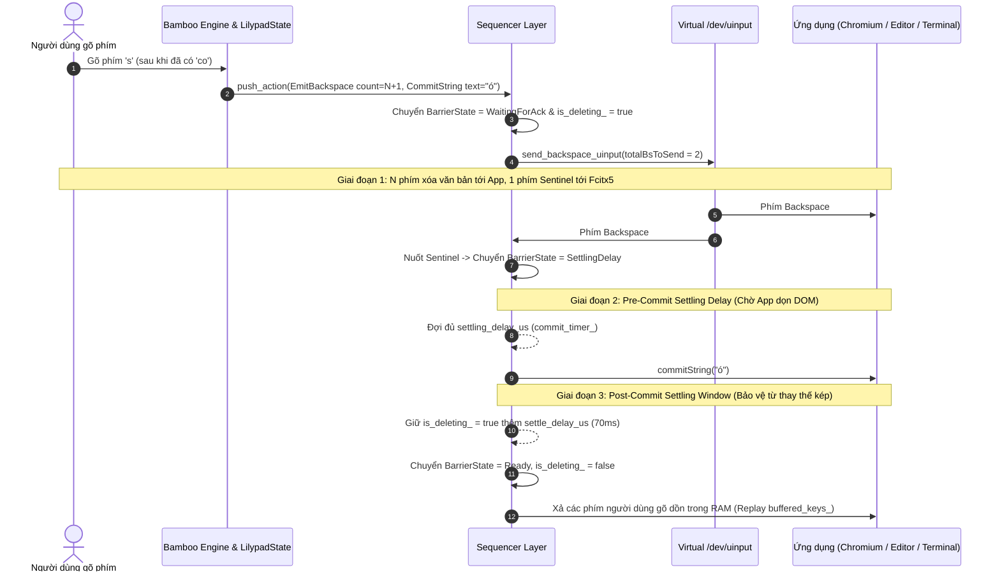

# ĐẶC TẢ CƠ CHẾ CẢM BIẾN, HỆ THỐNG GẮN CỜ & CÔNG THỨC TRỌNG SỐ SEQUENCER LAYER

@target: Sequencer Layer (`fcitx5-lilypad`) | @version: v2.3.11 Technical Analysis | @date: 2026-11-05

---

## 1. TỔNG QUAN VÒNG ĐỜI GIAO DỊCH SEQUENCER (TRANSACTION LIFECYCLE)

Khi gõ một từ tiếng Việt cần biến đổi (ví dụ: gõ `co` + `s` $\to$ `có`, hoặc `ban` + `j` $\to$ `bạn`), hệ thống trải qua một chu trình giao dịch gồm 4 giai đoạn nghiêm ngặt:



---

## 2. CÁC CƠ CHẾ GẮN CỜ HIỆN TẠI (FLAGGING MECHANISMS)

Hệ thống sử dụng 6 cờ trạng thái để kiểm soát chặt chẽ luồng thực thi:

| Tên Cờ (Flag / State) | Vị Trí Lưu Trữ | Điều Kiện Kích Hoạt / Gán Cờ | Ý Nghĩa Kỹ Thuật & Tác Động |
| :--- | :--- | :--- | :--- |
| **`wa_chromium_flag`** | `LilypadEngine` & `LilypadState` | Nhận diện chuỗi `appName` chứa: `chrome`, `chromium`, `electron`, `affine`, `antigravity`, `slack`, `discord`, `brave`, `edge`, `code`... | Đánh dấu ứng dụng có kiến trúc đa tiến trình (Multi-Process Rendering) và cây DOM phức tạp. Kích hoạt toàn bộ cơ chế bảo vệ vi mô dành riêng cho Chromium. |
| **`is_deleting_`** | `std::atomic<bool>` trong `LilypadState` | Được gán `= true` khi bắt đầu `performReplacement`. Được gán `= false` sau khi hết thời gian Post-Commit Settling Window. | **Rào chắn nguyên tử (Atomic Lock):** Khi cờ này bật, bất kỳ phím mới nào người dùng gõ đều **không được bắn thẳng xuống app** mà lập tức đẩy vào hàng đợi RAM (`buffered_keys_`), triệt tiêu hoàn toàn race condition làm hỏng từ. |
| **`BarrierState`** | `Sequencer` | Gồm 4 trạng thái: `Ready`, `WaitingForAck`, `SettlingDelay`, `AppLagHolding`. | **Máy trạng thái của Sequencer:**<br>• `WaitingForAck`: Chờ uinput phát xong phím xóa.<br>• `SettlingDelay`: Đã xóa xong, chờ DOM ứng dụng ổn định con trỏ.<br>• `AppLagHolding`: App bị đơ, tự động giữ phím trong RAM.<br>• `Ready`: Rảnh rỗi. |
| **`isTabLagging()`** | Phương thức động trong `LilypadState` | Đánh giá tức thì dựa trên 4 tín hiệu cơ học runtime:<br>1. Thời gian nuốt $\ge 12\text{ms}$.<br>2. Hàng đợi có $\ge 2$ phím hoặc phím chờ $\ge 15\text{ms}$.<br>3. Độ trễ ACK đo được $\ge 30\text{ms}$.<br>4. Có Focus Bounce trong 3 giây gần nhất. | Xác định tab hiện tại đang mượt mà (Facebook, Docs) hay đang bị quá tải DOM / Lag (TikTok 25K bình luận, AFFiNE Canvas). |
| **`deferredFocusOut_`** | `LilypadState` | Kích hoạt khi nhận sự kiện `FocusOut` ở chế độ Uinput/Sequence. | **Bảo vệ chống nảy tiêu điểm ảo (Focus Bounce):** Trì hoãn việc reset bộ nhớ từ trong $100\text{ms}$. Nếu trong $100\text{ms}$ có `FocusIn` quay lại (như TikTok re-render DOM), trạng thái từ được giữ nguyên vẹn $100\%$. |
| **`expected_swallow_backspaces_`** | `std::atomic<int>` trong `Sequencer` | Khởi tạo bằng số phím xóa cần phát: $N + 1$ (với $N$ là số ký tự cần xóa, $+1$ là Sentinel). | **Bộ đếm token nuốt phím:** Mỗi phím Backspace dội về từ uinput sẽ trừ 1 token. Khi token chạm 0, phím Backspace cuối cùng (Sentinel) sẽ bị Fcitx5 nuốt trọn (`filterAndAccept`), không cho lọt xuống app. |

---

## 3. CÁC TRỌNG SỐ THAM GIA & CÔNG THỨC TOÁN HỌC HIỆN TẠI

### 3.1. Cảm biến nhịp ngón tay (`IIkiSensor` / `StandardIkiSensor`)
- Đo khoảng cách thời gian $\Delta t$ giữa 2 lần nhấn phím liên tiếp của người dùng.
- Làm mượt qua công thức Trung bình Động Hàm mũ (EMA):
  $$\text{EMA\_IKI}_n = 0.2 \cdot \Delta t_{\text{clamped}} + 0.8 \cdot \text{EMA\_IKI}_{n-1}$$
  *(trong đó $\Delta t_{\text{clamped}} = \text{clamp}(\Delta t, 35\text{ms}, 300\text{ms})$)*

- **Trọng số chuẩn hóa ngón tay $t$ (Feature Scaling):**
  $$t = \text{clamp}\left(\frac{\text{EMA\_IKI} - 35.0}{150.0 - 35.0},\ 0.0,\ 1.0\right)$$
  - Khi gõ lướt siêu tốc ($\text{EMA\_IKI} \le 35\text{ms}$): $t = 0.0$ (Burst Typing).
  - Khi gõ thong thả ($\text{EMA\_IKI} \ge 150\text{ms}$): $t = 1.0$ (Relaxed Typing).

---

### 3.2. Cảm biến đường truyền & Compositor (`IAckSensor` / `NiriAckSensor`)
Cảm biến này tính toán ra giá trị **`micro_delay_us` (con số `raw` trong log)**:

1. **Trường hợp Khởi động lạnh (`iki_ms == 0`):**
   $$\text{micro\_delay\_us} = 35000 + N \times 15000\ (\mu\text{s})$$
   *(1 phím xóa = $50\text{ms}$, 2 phím xóa = $65\text{ms}$ để bảo đảm chữ đầu tiên an toàn tuyệt đối)*.

2. **Trường hợp Bình thường (`iki_ms > 0`):**
   - **Độ trễ nền (Base Settling Delay):**
     $$\text{base\_us} = 1000.0 + t \times (15000.0 - 1000.0)\ (\mu\text{s})$$
     *(Gõ lướt $t=0 \implies 1\text{ms}$; Gõ thong thả $t=1 \implies 15\text{ms}$)*
   - **Độ trễ từng phím xóa (Tri-Layer Per-Backspace):**
     $$\text{min\_per\_bs} = 500.0 + t \times (18000.0 - 500.0)\ (\mu\text{s})$$
     $$\text{per\_bs\_us} = \max(\text{min\_per\_bs},\ \text{EMA\_swallow},\ \text{raw\_swallow})$$
   - **Tổng độ trễ cảm biến tính ra (`raw`):**
     $$\text{micro\_delay\_us} = \text{clamp}(\text{base\_us} + N \times \text{per\_bs\_us},\ 1000,\ 300000)$$

> **Minh họa bằng chính Log thực tế của từ `có` bạn vừa gõ:**
> - $N = 1$ (xóa 1 chữ 'o').
> - Bạn gõ nhịp $221\text{ms} \implies t = 1.0$.
> - $\text{base\_us} = 15000\mu\text{s}$ ($15\text{ms}$).
> - $\text{per\_bs\_us} = 18000\mu\text{s}$ ($18\text{ms}$).
> - $\text{raw} = 15000 + 1 \times 18000 = \mathbf{33000\mu\text{s}\ (33ms)}$.

---

### 3.3. Công thức tính `SettlingDelay` hiện tại (Bản v2.3.11 - Điểm gây ra lỗi)

Hiện tại, trong [`lilypad-state.cpp`](file:///home/chiconcota/Documents/vnlilypad-lotus/fcitx5-lilypad/src/lilypad-state.cpp#L1420-L1437):
```cpp
uint64_t LilypadState::calculateDynamicSettlingDelayUs(uint64_t micro_delay_us, uint64_t swallow_duration_us) {
    if (!wa_chromium_flag) {
        return 1500; // Native / Terminal apps
    }

    bool lagging = isTabLagging();
    if (!lagging) {
        // TAB MƯỢT (Facebook, Antigravity IDE...):
        uint64_t adaptive_delay = (swallow_duration_us > 0) ? (swallow_duration_us * 8 / 10) : 7000;
        uint64_t delay_us = std::clamp<uint64_t>(std::max<uint64_t>(adaptive_delay, 7000), 7000, 15000);
        return delay_us;
    }
    // TAB NẶNG / LAG...
}
```

#### Phân tích sai lầm cốt tử:
1. Giá trị `micro_delay_us` do cảm biến tính ra rất chuẩn mực là **$33\text{ms}$** (`raw=33000us`).
2. Nhưng nhánh tab mượt (`!lagging`) **hoàn toàn vứt bỏ biến `micro_delay_us`**, không thèm ngó ngàng tới nó!
3. Nó tính: $\text{swallow} = 1252\mu\text{s} \times 0.8 = 1001\mu\text{s}$.
4. Sau đó chạy lệnh: $\max(1001, 7000) = 7000\mu\text{s}$ ($7\text{ms}$).
5. **Hậu quả:** Sequencer chỉ đợi có đúng **$7\text{ms}$** đã vội vàng bắn `commitString("ó")`.
   - Trong khi đó, màn hình 60Hz cần **$16.6\text{ms}$** cho 1 khung hình render. Trình soạn thảo Lexical/Chromium chưa kịp xóa xong chữ `o` trên DOM và con trỏ đang khóa.
   - Ký tự `ó` bắn vào lúc con trỏ khóa $\implies$ **Bị Chromium nuốt chửng** $\implies$ Từ `có` chỉ còn lại chữ `c`!

---

## 4. PHÂN TÍCH THAY ĐỔI: SỬA CÁI GÌ, VÌ SAO VÀ CÔNG THỨC MỚI LÀ GÌ?

### 4.1. Vì sao phải thay đổi?
- **Khuyết tật của cách cũ:** Tự tiện vứt bỏ kết quả của cảm biến ngón tay (`raw=33000us`) và gán cứng một con số $7\text{ms}$. Con số $7\text{ms}$ này nhỏ hơn chu kỳ 1 khung hình quét màn hình 60Hz ($16.6\text{ms}$), dẫn tới việc commit đâm sầm vào quá trình render của trình duyệt.
- **Mục tiêu mới:** 
  1. Phải **tôn trọng giá trị tính toán của cảm biến IKI** (`micro_delay_us`).
  2. Phải tôn trọng **chu kỳ khung hình phần cứng của Chromium**: Mức sàn tối thiểu trên Chromium không bao giờ được phép thấp hơn 1 khung hình render ($16\text{ms} = 16000\mu\text{s}$).

---

### 4.2. Công thức mới đề xuất (v2.3.12)

Trong hàm `calculateDynamicSettlingDelayUs()`:

```text
┌────────────────────────────────────────────────────────────────────────┐
│                        CÔNG THỨC ĐIỀU TỐC MỚI                          │
│                                                                        │
│  1. Nếu là Native App / Terminal (!wa_chromium_flag):                  │
│     delay = 1500us (1.5ms - Siêu tốc tức thì)                         │
│                                                                        │
│  2. Nếu là Chromium / Electron (wa_chromium_flag == true):             │
│     - Tab Mượt (!lagging):                                             │
│       delay = clamp(micro_delay_us, 16000us, 35000us)                  │
│       (Lấy trực tiếp theo cảm biến, chặn sàn 16ms = 1 frame 60Hz)     │
│                                                                        │
│     - Tab Nặng / Lag (isTabLagging() == true):                         │
│       dynamic_floor = clamp(swallow_duration * 0.8, 16000, 35000)      │
│       delay = clamp(max(micro_delay_us, dynamic_floor), 16000, 100000) │
└────────────────────────────────────────────────────────────────────────┘
```

---

### 4.3. Bảng so sánh trực quan giữa Công thức cũ và Công thức mới

| Tình Huống Thực Tế | Nhịp Ngón Tay | Cũ (v2.3.11 - Lỗi) | Mới (v2.3.12 - Chuẩn Xác) | Trạng Thái & Trải Nghiệm Thực Tế |
| :--- | :--- | :--- | :--- | :--- |
| **Gõ từ `có` thong thả trên Antigravity IDE** | $221\text{ms}$ (Thong thả) | Ép về **$7\text{ms}$** *(Vứt bỏ raw $33\text{ms}$)* $\implies$ **Lỗi nuốt chữ `c`** | Lấy đúng **$33\text{ms}$** theo cảm biến $\implies$ **Ra chuẩn chữ `có`** | App có trọn vẹn 2 khung hình để xóa DOM sạch sẽ. Đối với ngón tay $221\text{ms}$, $33\text{ms}$ là vô hình, gõ mượt mà. |
| **Gõ từ `bạn` thong thả trên Antigravity IDE** | $204\text{ms}$ (Thong thả) | Ép về **$7\text{ms}$** $\implies$ **Lỗi nuốt chữ `b`** | Lấy đúng **$35\text{ms}$** theo cảm biến $\implies$ **Ra chuẩn chữ `bạn`** | Sửa dứt điểm lỗi nuốt cụm `ạn` trên Lexical Editor. |
| **Gõ lướt cực nhanh (Burst Typing)** | $\le 50\text{ms}$ (Siêu tốc) | Bị kẹt cứng ở $7\text{ms}$ | Tự co về mức sàn **$16\text{ms}$** (vừa khít 1 frame 60Hz) | Chữ nổ ra tức thì sau nhịp Backspace, không hề có cảm giác khựng. |
| **Tab cực nặng (TikTok 25K bình luận, AFFiNE)** | Bất kỳ | Tự dãn $35\text{ms} \sim 69\text{ms}$ | Tự dãn $35\text{ms} \sim 70\text{ms}$ (cộng dồn áp lực hàng đợi) | Bảo vệ an toàn tuyệt đối, không vỡ từ trên web nặng. |
| **Terminal / CLI (Kitty, Ghostty, Alacritty)** | Bất kỳ | $1.5\text{ms}$ | $1.5\text{ms}$ | Giữ nguyên độ trễ cực tiểu, gõ lướt tức thì. |

